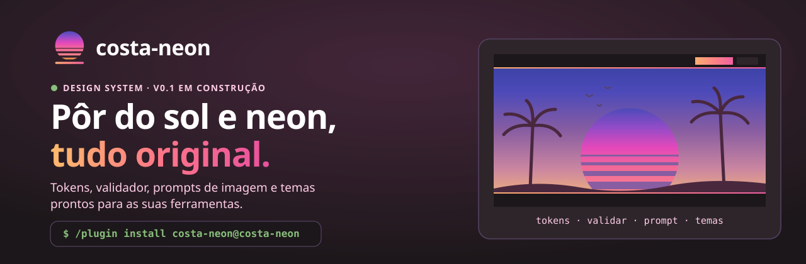
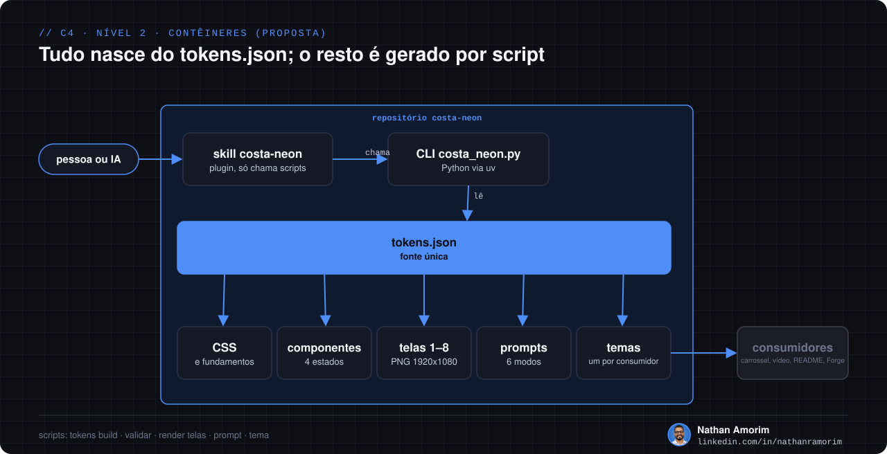

<p align="center">
  
</p>

<p align="center">
  
  
  
  
</p>

<h3 align="center">Tokens, validador, prompts de imagem e temas<br>prontos para as suas ferramentas.</h3>

---

## O que é

**Costa Neon** é um design system de pôr do sol tropical: céu rosa, laranja e roxo, palmeiras em silhueta, art déco em tons pastel e neon. Você (ou a sua IA) pede e um script responde sempre igual, sem inventar cor.

Já funciona:
- **tokens** (62 cores, degradês, tipografia, espaçamento, raios e sombras) em JSON e em variáveis CSS;
- **validar**, que reprova cor fora dos tokens, preto puro, sombra que não seja roxa ou azul, contorno fora da tinta e nome de obra existente;
- **prompt**, que monta prompts de imagem e roteiros de texto em 6 modos, com sorteio repetível;
- **tema**, que gera o arquivo que cada ferramenta já lê: carrossel-studio, gerador-videos, readme-studio e Forge SDD "Edição Missões".

Ainda vão chegar: página de fundamentos, componentes com estados e as 8 telas de referência em 1920x1080.

É replicável: troque `{MARCA}`, `{CIDADE}`, `{IDIOMA}` e `{FORMATO}` (os exemplos usam Acme e Palmarena, nomes inventados). Tudo é original: nenhum logo, nome, personagem, mapa ou fonte de jogo, filme ou marca existente.

## Por que usar

| | |
|---|---|
| **Um valor, um lugar** | Cada cor existe uma vez, no `tokens.json`. CSS e temas saem dele. |
| **A IA não chuta cor** | Ela usa `validar`, `prompt` e `tema` como ferramentas e recebe sempre o mesmo resultado. |
| **Original de verdade** | Paleta própria, fontes abertas (display Bowlby One), nomes inventados. |
| **Roda em qualquer sistema** | macOS, Linux e Windows, Python só pelo `uv`, sem dependência externa. |

## Requisitos

Só o `uv` (os scripts usam apenas a biblioteca padrão do Python) e, enquanto o repositório for privado, acesso ao GitHub. Navegador e fontes só entram quando as telas existirem.

> **Cole isto na sua IA antes de instalar:**
>
> "Confira os requisitos do costa-neon. Se o repositório ainda não estiver clonado, clone com o GitHub CLI: `gh repo clone nathanramorim/costa-neon` (instale o gh com `winget install --id GitHub.cli -e` no Windows, pelo https://cli.github.com no macOS e pelo pacote `gh` da sua distro no Linux; o `gh auth login` é comigo). No Windows, rode `powershell -ExecutionPolicy Bypass -File scripts/bootstrap.ps1`; no macOS ou Linux, rode `sh scripts/bootstrap.sh`. Ele confere e, com o meu ok, instala o uv, e depois mostra o que falta. Para cada item, peça meu ok e rode `uv run scripts/requisitos.py instalar --sim <item>`. Itens marcados como é com você (licença, consentimento ou voz, login, permissões do sistema, senha de administrador): me explique e espere eu fazer. Não aceite licenças nem declarações por mim e não mexa em senhas, chaves ou tokens."

| | O que precisa | Detalhe |
|---|---|---|
| **Onde roda** | macOS, Linux e Windows | O CI roda os testes nos 3 sistemas (`.github/workflows/ci.yml`); a receita de requisitos cobre os 3 (`uv run scripts/requisitos.py validar`). No dia a dia, testado no macOS (arm64) com Claude Code. |
| **Programas** | `uv` 0.8 ou mais novo (obrigatório); `git` 2.0+ e `gh` (para clonar o repositório privado) | `uv run scripts/requisitos.py checar` confere tudo e diz o que falta. Python sempre pelo [`uv`](https://docs.astral.sh/uv/). |
| ↳ macOS | `sh scripts/bootstrap.sh` | Instalador oficial do `uv` (sem sudo), com o seu ok; Homebrew é só uma opção, se você já tiver. |
| ↳ Linux | `sh scripts/bootstrap.sh` | Instalador oficial do `uv`; `pacman` ou `dnf` quando houver. `git` e `gh` pelo gerenciador da distro. |
| ↳ Windows | `powershell -ExecutionPolicy Bypass -File scripts/bootstrap.ps1` | Instalador oficial do `uv`, ou `winget`, `scoop` e `choco`. O `winget` pede a você o aceite dos termos. |
| **Downloads na primeira execução** | Nenhum | Os comandos de hoje não baixam nada. Quando as telas existirem: fontes abertas do fontsource em `~/.cache/costa-neon/fontes`, uma vez. |
| **Contas e chaves** | Conta no GitHub com acesso a este repositório privado | `gh auth login` é com você; a IA nunca digita senha nem token. Nenhuma chave fica no repositório. |
| **Máquina** | Qualquer computador que rode o `uv` | Sem requisito de memória ou GPU. |
| **Licenças e limites de uso** | Código MIT; fontes previstas todas OFL-1.1 | Bowlby One, Josefin Sans, Outfit, Kaushan Script, Zilla Slab, Anton, Oswald e JetBrains Mono (conferido no fontsource em 19/11/2026). |
| **O que você fornece** | Os valores de `{MARCA}` e `{CIDADE}` (inventados) | Foto de pessoa só com autorização dela, só adultos, sem figuras públicas (`prompt --modo 2 --foto-autorizada`). |

## Instalação

Como plugin do Claude Code (com acesso ao repositório):

```
/plugin marketplace add nathanramorim/costa-neon
/plugin install costa-neon@costa-neon
```

Depois peça em conversa ("me dá o tema do Costa Neon para o carrossel") ou use `/costa-neon`.

Sem plugin, direto do clone:

```bash
gh repo clone nathanramorim/costa-neon
cd costa-neon
uv run scripts/requisitos.py checar
```

## Como usar

Os comandos rodam da raiz do clone (no plugin, a skill chama o mesmo script):

```bash
CN=plugins/costa-neon/skills/costa-neon/scripts/costa_neon.py
uv run $CN tokens build                                   # CSS a partir do tokens.json
uv run $CN validar caminho/da/peca                        # 0 ok, 2 lista o que está fora
uv run $CN tema todos --saida meu-tema --previa           # um arquivo por ferramenta + prévia SVG
uv run $CN prompt --modo 3 --semente 7                    # personagem aleatório (mesma semente, mesmo texto)
uv run $CN prompt --modo 6 --tema capa --descricao "a pink motel sign at dusk"
```

| Tema | Arquivos | Para |
|---|---|---|
| `carrossel` | `marca.json`, `marca/logo.svg` | carrossel-studio (`--marca`) |
| `video` | `.video-marca.json`, `marca/logo.svg` | gerador-videos (coloque em `conteudo/`) |
| `readme` | `identidade.json`, `logo.svg.frag` | banner do readme-studio (este README usa) |
| `forge-sdd` | `forge-sdd-missoes.json`, `logo.svg` | Forge SDD "Edição Missões": as 5 estações como missões |

Guia de ilustração e os 6 modos: [`plugins/costa-neon/skills/costa-neon/ilustracao/GUIA.md`](plugins/costa-neon/skills/costa-neon/ilustracao/GUIA.md). Fonte de verdade do estilo: [`docs/prompt-diretor-de-arte.md`](docs/prompt-diretor-de-arte.md); onde diverge, valem as ADRs (paleta deslocada na ADR-0007, display Bowlby One na ADR-0002).

<p align="center">
  
</p>

## Segurança e privacidade

- Nenhum segredo no repositório; os scripts não acessam a internet nem enviam nada.
- `tema` só escreve na pasta `--saida`; `--validar` não grava nada.
- Prompts de imagem nunca citam obra, marca ou personagem existente; o script recusa nomes conhecidos.
- Foto de pessoa só com autorização dela, só adultos, sem figuras públicas. A autorização é sua, nunca da IA.

## Versões

| Versão | Novidades |
|---|---|
| 0.1.0 (em construção, sem tag) | Tokens com paleta própria, `validar`, `prompt` em 6 modos, temas para 4 ferramentas e plugin. |

## Licença

[MIT](LICENSE). As fontes previstas são todas OFL-1.1.
