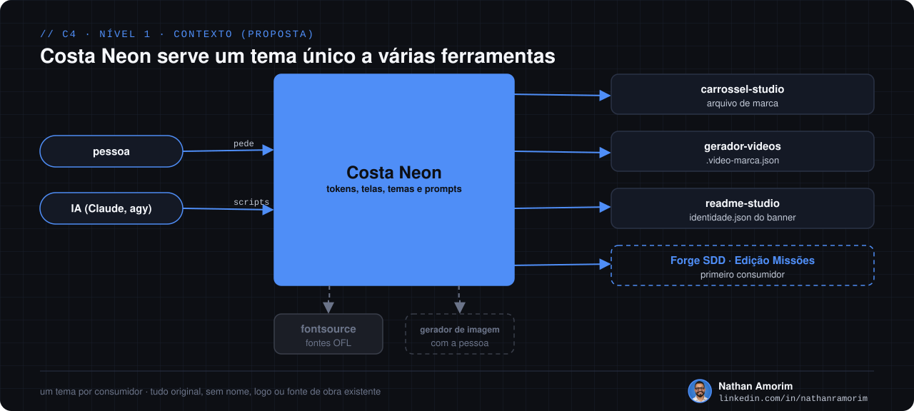
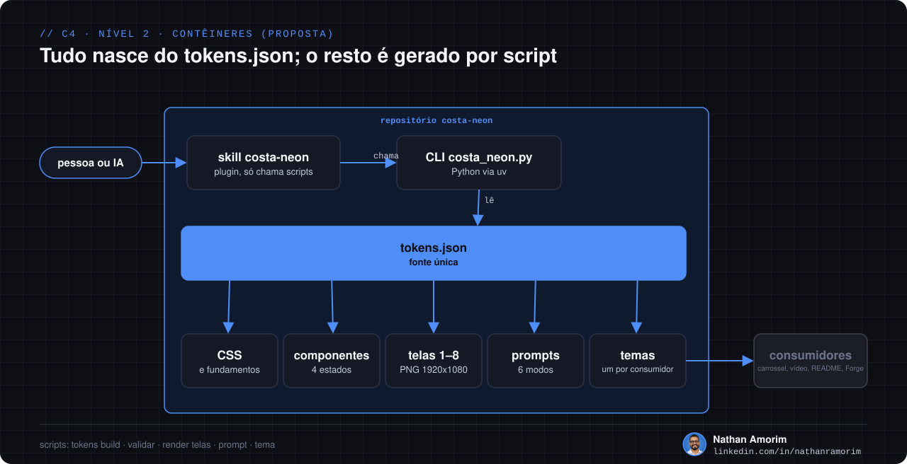
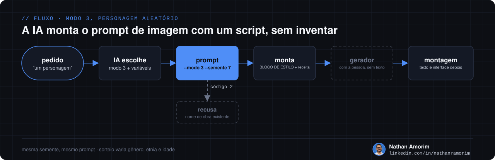

# Critérios — 01 costa-neon

## Modelo do módulo
`completo` (`ARQ-11`). O repositório tem 7 módulos com contrato público (tokens, validar, fundamentos, componentes, telas, ilustracao, temas) e consumidores externos; um modelo enxuto não daria conta dos contratos de cada tema.

## Decisões do projeto aplicadas
| Decisão | Onde | O que a spec respeita |
|---------|------|-----------------------|
| ADR-0001 tokens como fonte única | `tokens/` | Todo valor nasce no `tokens.json`; CSS, telas e temas são gerados (`DUP-04`) |
| ADR-0002 originalidade e fontes abertas | regra 4, 5 e 11 | Bowlby One padrão, Pricedown fora; HUD com layout próprio; nomes inventados; fotos com autorização |
| ADR-0003 uv multiplataforma | regra 9 | Scripts PEP 723, `pathlib`, sem shell; CI macOS, Linux, Windows |
| ADR-0004 render no Chrome local (proposto) | `telas/` | HTML -> PNG 1920x1080; confirmar no Gate 1 |
| ADR-0005 plugin e temas por consumidor (proposto) | `plugins/`, `temas/` | Skill chama scripts; um export por consumidor |
| ADR-0006 docs, requisitos e diagramas | README, `scripts/`, `docs/diagramas/` | readme-studio + motor v0.1.0; diagram-studio |
| Módulos e fluxos | `sdd/spec/modules.md`, `flows.md` | Dependências apontam para `tokens`, sem ciclos (`ARQ-02`) |

## O que já existe
| Procurei | Onde | Achei | Decisão | Justificativa |
|----------|------|-------|---------|---------------|
| Render HTML -> PNG com fontes | carrossel-studio (`sdd/spec/adr/adr-0002-render-html-chrome-local.md`) | Playwright + Chrome do sistema, fallback Chromium | reusar (padrão) | Mesmo problema, já testado nos 3 sistemas |
| Cache de fontes abertas | carrossel-studio (regra 10) | fontsource via jsDelivr, cache em `~/.cache/<projeto>/fontes` | reusar (padrão) | Licença OFL, baixa uma vez |
| Formato de marca de carrossel e vídeo | carrossel-studio `sdd/spec/contrato-carrossel.md`; gerador-videos `/video-marca` | JSON `cores`/`fontes`/`logo`; `.video-marca.json` | estender (export) | O tema gera o formato que eles já leem; nada novo para eles |
| Identidade de banner | readme-studio `exemplos/forge-sdd/identidade.json` | chaves fundo, brilho, texto, suave, acento[3], painel, borda, fontes, logo | reusar | `tema readme` gera esse arquivo; este README já usa |
| Motor de requisitos | requisitos-para-ia tag `v0.1.0` | `requisitos.py`, `bootstrap.sh`, `bootstrap.ps1` | reusar (vendorizado sem edição) | Padrão dos repositórios do dono (ADR-0006) |
| Tokens do tema 5.0 | forge-sdd branch `feat/readme-v5-gta-vi` (`docs/design/gta-vi/tokens.*`) | 400 linhas de tokens medidos de um conceito com direitos reservados, pilhas com Pricedown | **não reusar** | Conflita com ADR-0002 e com a decisão 101 do próprio forge-sdd; nossos valores vêm do prompt do Nathan |
| Estações e mascotes | forge-sdd `site/src/data/stations.ts`, `MascotFallbackSvg.astro` | 5 estações com cor e marca, mascotes próprios | estender (consumidor) | `tema forge-sdd` mapeia as 5 missões para cores da lista |
| Design system com a mesma proposta | `~/git` | nada equivalente | criar | Primeiro design system replicável do dono |

## Dependências novas
| Dependência | Versão | Por quê | Quando |
|-------------|--------|---------|--------|
| motor requisitos-para-ia | v0.1.0 (commit no `skills.lock`) | `## Requisitos` e bloco "Cole isto na sua IA" | agora (discovery) |
| playwright | fixar na feature 04 (consultar a documentação na versão exata, `SEG-07`) | render das telas | feature 04 |
| pillow | fixar na feature 04 | conferir tamanho 1920x1080 e folha de contato | feature 04 |
| pytest, ruff | grupo `dev` | `TST-01`, `COD-02` | feature 01 |

Nenhuma dependência de runtime entra nesta iniciativa de discovery.

## Rules e IDs da Constituição Aplicáveis
`.agents/rules/sdd-arquitetura.md` (`ARQ-02`, `ARQ-03`, `ARQ-04`, `ARQ-06`, `ARQ-11`), `sdd-codigo-e-testes.md` (`COD-02`, `TST-01`, `TST-03`, `TST-04`), `sdd-reuso-e-duplicacao.md` (`DUP-01`..`DUP-04`), `sdd-seguranca.md` (`SEG-01`, `SEG-02`, `SEG-03`, `SEG-05`, `SEG-07`), `sdd-fluxo-e-portao.md` (`FLX-01`..`FLX-07`, `GOV-01`).

## Arquitetura (C4)
C4 é um jeito de desenhar um sistema em níveis de zoom, como um mapa: o **contexto** mostra quem usa o sistema e com quem ele conversa; os **contêineres** mostram as peças grandes por dentro (aqui: tokens, scripts, páginas, telas, temas). Desenhos feitos pela skill `diagramas-c4-mermaid` com o motor **diagram-studio** (SVG e PNG escuros), conferidos em imagem.

| Diagrama | Arquivo |
|----------|---------|
| Contexto: quem usa e quem consome |  |
| Contêineres: as peças por dentro |  |
| Sequência: a IA monta um prompt de imagem |  |

Fontes em JSON ao lado (`docs/diagramas/*.json`); PNG para slides e chat.

## Critérios de Aceitação Executáveis
Critério de aceitação é uma frase que um comando consegue provar sozinho, sem opinião. Exemplo: "a tela 3 tem 1920x1080" vira um teste que abre o PNG e confere o tamanho.

### Desta discovery (Gate 1)
| # | Critério | Comando |
|---|----------|---------|
| D1 | Contexto do projeto pronto | `forge brief --check` sai 0 |
| D2 | README passa no verificador do readme-studio | `uv run <readme-studio>/scripts/verificar_readme.py README.md` sai 0 |
| D3 | Receita de requisitos válida nos 3 sistemas | `uv run scripts/requisitos.py validar` sai 0 |
| D4 | Motor igual ao da tag `v0.1.0` | sha256 de `scripts/requisitos.py`, `bootstrap.sh`, `bootstrap.ps1` = `skills.lock` |
| D5 | Prompt guardado sem alteração | `docs/prompt-diretor-de-arte.md` igual ao texto entregue pelo Nathan |
| D6 | Diagramas renderizados | `docs/diagramas/*.svg` e `*.png` existem para cada `*.json` |

### Das features (para o `/split-features`)
| # | Feature | Critério | Como provar |
|---|---------|----------|-------------|
| C1 | 01 | `tokens.json` contém exatamente os 62 hex do prompt (lista em `tests/dados/hex-prompt.txt`) e a sombra `rgba(40,10,40,0.45)`; `tokens build` gera CSS com uma variável por token | `uv run pytest tests/test_tokens.py` |
| C2 | 01 | `validar` sai 0 nos arquivos oficiais e sai 2 em cada fixture ruim: hex fora da lista, sombra preta ou cinza, contorno `#000000`, tela sem barra `#171717` de 9% ou sem linha neon, "Pricedown" ou nome de obra existente só nos artefatos distribuídos (`tokens/`, `fundamentos/`, `componentes/`, `telas/`, `ilustracao/`, `temas/`, `plugins/`, `README.md`), nunca em `sdd/` nem no `docs/prompt-diretor-de-arte.md` | `uv run pytest tests/test_validar.py` |
| C3 | 02 | Página de fundamentos mostra uma amostra por token de cor e degradê e a escala tipográfica do prompt (50/22/48/20/20/18/19/30 px) | teste conta amostras = tokens; PNG conferido |
| C4 | 03 | Cada componente tem os 4 estados (normal, foco, ativo, desabilitado) e só usa `var(--cn-*)`; no máximo 1 gradiente de acento por tela | `uv run pytest tests/test_componentes.py` |
| C5 | 04 | `render telas` gera 8 PNG de 1920x1080; `validar` aprova as 8; folha de contato olhada pelo agente | `uv run pytest tests/test_telas.py` + leitura da folha |
| C6 | 05 | `prompt --modo 1..6` começa pelo BLOCO DE ESTILO literal; mesma `--semente` dá o mesmo texto; variável com nome de obra existente (lista de teste) sai 2 | `uv run pytest tests/test_prompt.py` |
| C7 | 06 | `tema carrossel` passa no `--validar` do carrossel-studio; `tema readme` tem as chaves do exemplo do readme-studio; `tema video` e `tema forge-sdd` seguem o contrato em `sdd/spec/` | `uv run pytest tests/test_temas.py` |
| C8 | 01..07 | Suíte e lint verdes em macOS, Linux e Windows | CI com matriz de 3 sistemas: `uv run ruff check` e `uv run pytest` |
| C9 | 07 | README refeito com as telas reais passa no verificador; diagramas atualizados | D2 + D6 |
