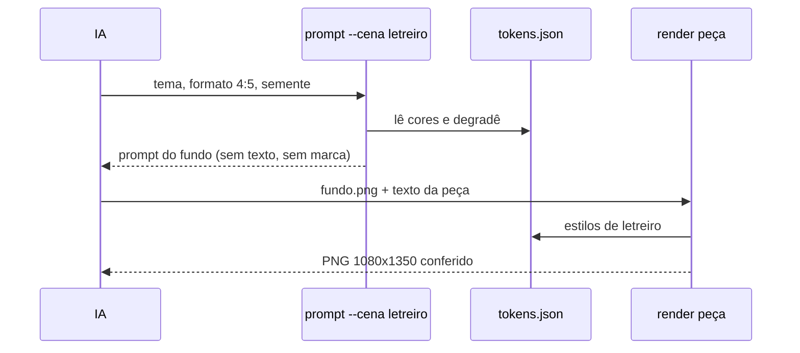

# Critérios — 02 letreiro-neon

## Modelo do módulo
`enxuto` (`ARQ-11`): estende os módulos `tokens`, `validar`, `ilustracao` e `temas` da 01, sem módulo novo nem contrato externo novo além de um tema.

## Decisões do projeto aplicadas
| Decisão | O que a spec respeita |
|---------|-----------------------|
| ADR-0001 fonte única | Cores, degradês e estilos de letreiro nascem em `tokens.json`; CSS e temas são gerados |
| ADR-0002 originalidade e fontes abertas | Inspirado, nunca copiado; sem Pricedown; fontes OFL ou Apache; nomes inventados |
| ADR-0003 uv | Scripts PEP 723, `pathlib`, sem shell |
| ADR-0004 render no Chrome local | Peça HTML -> PNG, conferida por imagem (Regra 11) |
| ADR-0005 plugin e temas | Tema do carrossel e do forge-sdd ganham as cores de letreiro |
| ADR-0007 paleta deslocada | Hex novos deslocados; `tokens.json` é a fonte do hex final |

## O que já existe
| Procurei | Onde | Achei | Decisão | Justificativa |
|----------|------|-------|---------|---------------|
| Tokens de cor, degradê, sombra | `plugins/costa-neon/skills/costa-neon/tokens/costa-neon.tokens.json` | `cores`, `degrades`, `sombras`, `tipografia` | estender | Mesma casa para cada valor (`DUP-01`) |
| Validador de hex e contorno | `scripts/validar.py` (01-01) | Reprova hex fora do `tokens.json` e contorno fora da tinta | estender | Exceção do contorno claro entra como token, não como regra solta |
| BLOCO DE ESTILO e receitas | `ilustracao/estilo.txt`, `receitas.json`, `listas.json`, `tematica.json` | 4 receitas e listas de sorteio | estender | Novo modo e novas listas, mesmo motor com `--semente` |
| Comando `prompt` (6 modos) | `scripts/` (01-05) | Modo 6 é post/peça | estender | Reaproveitar o modo 6 com `--cena letreiro` |
| Temas por consumidor | `tema carrossel`, `tema forge-sdd` (01-06) | Export JSON a partir dos tokens | estender | Só novas chaves de cor e fonte |
| Render HTML -> PNG | ADR-0004, carrossel-studio | Chrome local | reusar | Já decidido |
| Fonte condensada pesada OFL | fontsource | Candidatas a conferir: Anton (já na 01), Barlow Condensed, League Gothic | decidir na 02-02 | Licença e peso conferidos na API antes de entrar |

## Dependências novas
Nenhuma de runtime. Fontes novas, se houver, entram pelo cache do fontsource (`SEG-07`: conferir licença e versão na 02-02).

## Rules e IDs aplicáveis
`DUP-01`, `DUP-04`, `ARQ-06`, `ARQ-11`, `COD-02`, `TST-01`, `TST-02`, `SEG-01`, `SEG-07`, `GOV-01`, `FLX-01`.

## Arquitetura (C4)
Sem mudança de contêineres: a 01 já desenha tokens, scripts, ilustração e temas. A 02 só acrescenta conteúdo. Diagramas da 01 em `docs/diagramas/` seguem válidos.

## Critérios de aceitação executáveis
| # | Critério | Comando |
|---|----------|---------|
| D1 | Contexto pronto | `forge brief --check` sai 0 |
| A1 | Cores novas (lima, degradê de céu, painel de letreiro) existem só no `tokens.json` e o CSS está em dia | `uv run costa_neon.py tokens build --checar` sai 0 |
| A2 | `validar` reprova hex lima fora dos tokens e aceita o do token | `uv run pytest tests/test_validar.py` |
| A3 | Todo par texto/fundo do letreiro tem contraste >= 4,5:1 (>= 3:1 em título grande) | `uv run pytest tests/test_contraste.py` |
| A4 | Contorno claro só no `painel-letreiro`; qualquer outro contorno fora da tinta reprova | `uv run costa_neon.py validar` |
| B1 | Fonte de letreiro com licença OFL ou Apache e sem Pricedown nem similar bloqueada | `uv run pytest tests/test_fontes.py` |
| C1 | `prompt --cena letreiro --semente N` é determinístico, sem termo bloqueado e sem pedir texto na imagem | `uv run pytest tests/test_prompt.py` |
| C2 | Listas de cenário têm moldura de silhuetas, céu, skyline, ponte, carro e helicóptero, todos sem marca | `uv run pytest tests/test_listas.py` |
| D2 | Peça 4:5 sai 1080x1350 e 1:1 sai 1080x1080, com título, 2 painéis, faixa de chamada e rodapé | `uv run pytest tests/test_peca.py` |
| D3 | Conferência visual: o agente olha o PNG e o compara lado a lado com a referência (sem cópia de layout, texto ou arte) | Regra 11, parecer da Camada B |
| T1 | Lint e testes | `uv run ruff check` e `uv run pytest` |
