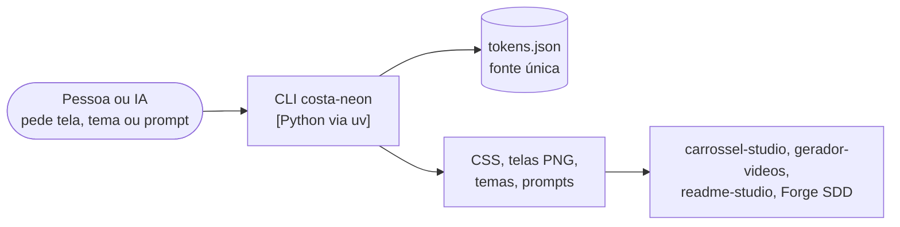

# Overview — costa-neon

Design system replicável **Costa Neon**: pôr do sol tropical, neon, art déco em tons pastel. Entrega tokens (JSON e CSS), página de fundamentos, componentes com estados, 8 telas de referência em 1920x1080, guia de ilustração (BLOCO DE ESTILO e receitas) e um tema exportado para cada ferramenta consumidora. Fonte de verdade: `docs/prompt-diretor-de-arte.md`. Estado: em discovery (iniciativa `01`).

## Índice
- `stack.md` — tecnologias
- `modules.md` — módulos e limites
- `flows.md` — fluxos principais
- `decisions.md` — decisões e ADRs
- `concepts.md` — um conceito, uma casa

## Arquitetura (C4, proposta)
Diagramas renderizados pelo diagram-studio em `docs/diagramas/` (contexto e contêineres). Resumo em texto:

